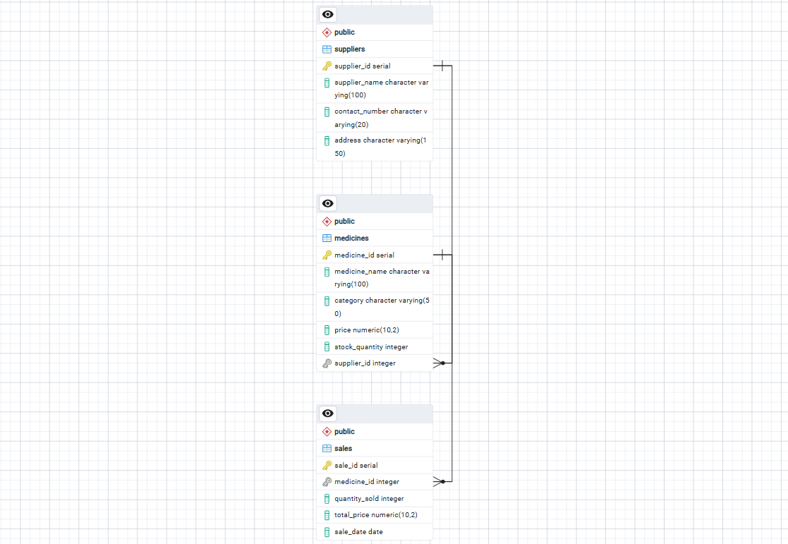

# Pharmacy Database System – Assignment III

**Student Name:** Osman Sayed Anwer 
**Registration Number:** 202513193
**Course / Module:** SQL Databases

---

## 1. Business Idea & System Overview

### Overview
This project models a relational database management system designed for a pharmacy retail and distribution business. The core objective is to efficiently manage supplier relationships, pharmaceutical inventory levels, pricing structures, and daily sales transactions. The system ensures data integrity through relational constraints, supports dynamic inventory modifications, and provides analytical retrieval capabilities for operational reporting.

### Core Entities
* **Suppliers:** Manages details of pharmaceutical manufacturing and distribution companies providing medical stock to the pharmacy.
* **Medicines:** Stores individual product records, including category classification, unit pricing, current stock levels, and associated suppliers.
* **Sales:** Tracks customer sales transactions, recording quantities sold, transaction dates, and total calculated revenue per order.

---

## 2. Table Structures & Schema Rules

The database consists of three primary interconnected tables enforcing strict relational constraints:

* **`suppliers`**
  * `supplier_id` (SERIAL, Primary Key): Unique identifier for each supplier.
  * `supplier_name` (VARCHAR, Not Null): Official name of the supplying company.
  * `contact_number` (VARCHAR): Direct communication phone number.
  * `email` (VARCHAR): Supplier contact email address (added via structural modification).

* **`medicines`**
  * `medicine_id` (SERIAL, Primary Key): Unique identifier for each medicine item.
  * `medicine_name` (VARCHAR, Not Null): Brand or generic name of the pharmaceutical product.
  * `category` (VARCHAR, Not Null): Therapeutic classification (e.g., Analgesic, Antibiotic).
  * `price` (NUMERIC, Not Null): Cost per unit.
  * `units_in_stock` (INT, Not Null): Current available quantity in inventory.
  * `supplier_id` (INT, Foreign Key referencing `suppliers(supplier_id)`): Links the medicine to its designated supplier.

* **`sales`**
  * `sale_id` (SERIAL, Primary Key): Unique identifier for each sales transaction.
  * `medicine_id` (INT, Foreign Key referencing `medicines(medicine_id)`): Identifies the medicine sold.
  * `quantity_sold` (INT, Not Null): Number of units purchased in the transaction.
  * `sale_date` (DATE, Not Null): Date when the sale occurred.
  * `total_price` (NUMERIC, Not Null): Total calculated cost of the transaction.

---

## 3. Entity-Relationship Diagram (ERD)

The Entity-Relationship Diagram below illustrates the relational structure, primary-to-foreign key mappings, and cardinalities between the `suppliers`, `medicines`, and `sales` entities.




---

## 4. Database Setup & Initialization

To initialize and run this database system:

1. Open your PostgreSQL environment (**pgAdmin**).
2. Open the script file provided in this repository: **`assignment_iii.sql`**.
3. Execute the script from top to bottom to drop existing schema versions, construct tables, seed initial records, and run all 15 operational tasks.

---

## 5. Tasks, Executions & Evidence

### Category 1: SELECT Queries (Q1.1 – Q1.3)

#### Task Q1.1: [Insert Task Title]
* **SQL Query:**
  ```sql
  -- Insert your Q1.1 SQL query here
